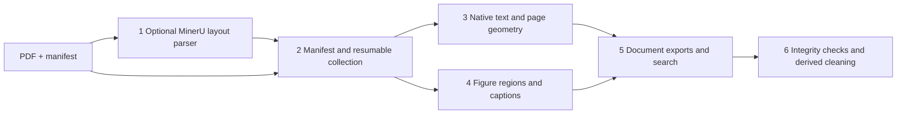

# Architecture guide for Kumar

**Purpose:** follow a PDF and its MinerU layout into source-linked text, preserved graphics and searchable records. Read modules in the numbered order below. The runnable example uses authored input, not a research paper or model prediction.

| Order | Code / key function | Concrete input → output |
|---|---|---|
| 1 | `scripts/convert_one.py:main`, `runtime_threads.py:configure_threads` | User PDF + installed local MinerU/models → middle JSON + parser receipt. Optional, not executed here. The demo supplies mock layout instead. |
| 2 | `portable/process_library.py:main`, `signature`, `publish_index` | `manifest.json` with PDF/layout/glyph-library paths → per-document publication receipts, progress states, indexes; unchanged completed input is skipped. |
| 3 | `portable/native_text.py:page_characters`, `extract`; `page_geometry.py:display_characters` | PDF native characters + layout bounding boxes → exact character-derived text, scripts, page coordinates and review flags. |
| 4 | `portable/build_native_assets.py:build_document`; `figure_regions.py:region`; `caption_links.py:associate` | Original PDF + mock/real `pdf_info[].para_blocks` → source crops, captions, figure/table/equation records and unresolved associations. |
| 5 | `portable/consumer_exports.py:export_document`, `build_search`; `search_assets.py:query` | Document records → `reading.md`, `llm.md`, `llm_blocks.jsonl`, `search.sqlite`; lexical query returns source image path, page and quality. |
| 6 | `portable/verify_production_collection.py:verify`; `clean_preserved_md.py:classify`, `clean_document` | Manifest + immutable receipts → integrity report; existing `llm.md` → derived cleaned Markdown + explicit removal log. |

**Figures and tables:** module 4 reconstructs a composite figure region from associated visual blocks/panels and its caption, preserving the full source crop; ambiguous cross-page associations remain review candidates rather than a stitched figure. Tables are preserved as original PDF region images with captions; any MinerU HTML transcription is retained separately as an unverified candidate, not asserted as a verified cell dataset.

**Trace the example:** `python examples/create_synthetic_input.py demo-input` makes `synthetic.pdf`, `layout.json`, an empty glyph library, and a manifest entry `{id: synthetic_001, pages: 1, staged: synthetic.pdf, layout: layout.json, sha256: computed}`. The PDF has two body regions, a drawn figure with one caption and the illustrative equation `y = x + 1`. Processing yields two preserved assets; searching `ozone` with `--kind equation` returns `synthetic_001:equation:1`, page 1, a crop path and `quality: unreviewed`. The result is evidence navigation, not verified equation transcription.

**Learning sequence:** run the README example → inspect one manifest and `blocks.jsonl`/`assets.jsonl` → read modules 2, 3 and 4 → inspect export/search schemas in module 5 → run the failure-oriented tests and inspect module 6 → only then study parser/model setup in module 1. Glyph repair (`glyph_library.py`) and archive import (`import_parse_outputs.py`) are optional extensions. Integrity and tests cannot certify scientific meaning.
